# Репозиторий по MOiBD

```
repos
|
|-3 Курс // Старый репозиторий
|-movie-recommender // Рекомендаций по фильмам
|-turkish_homes // Обучение модели по турецким домам
|-images/* // изображения для Readme
```

---

### 1 Персональные рекомендаций для 1 пользователя

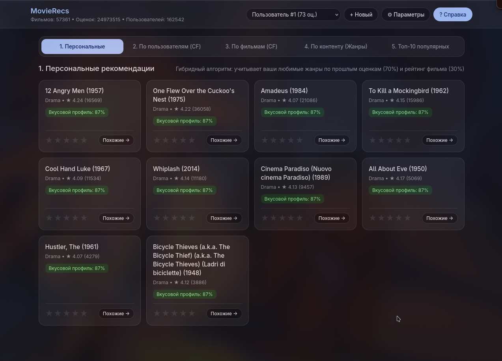

---

### 2 Коллаборативная фильтрация пользователям

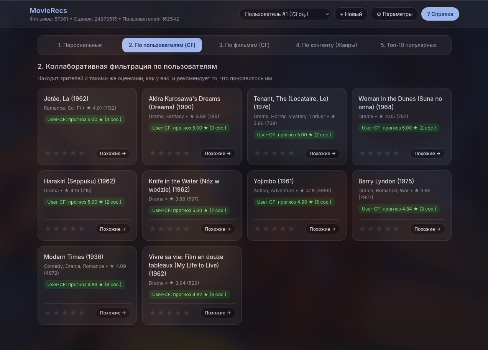

---

### 3 Коллаборативная фильтрация по фильмам

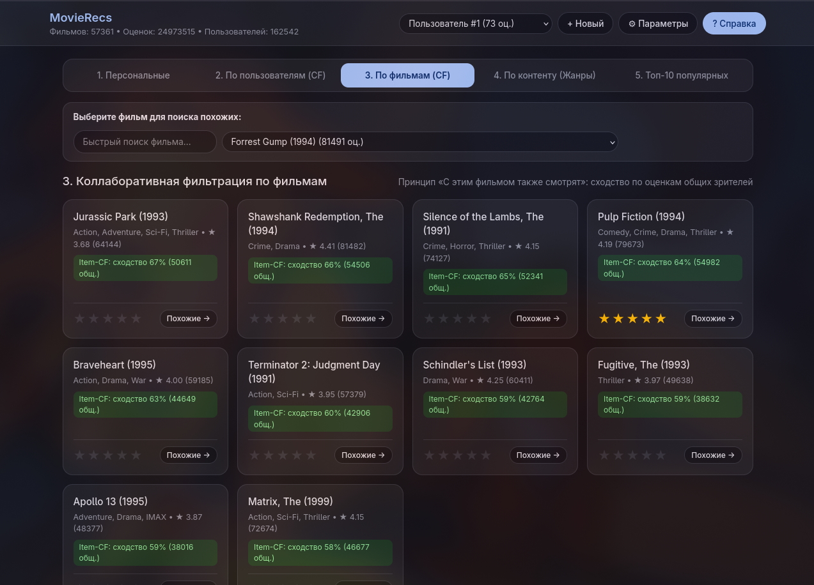

---

### 4 Похожие по контенту фильмы

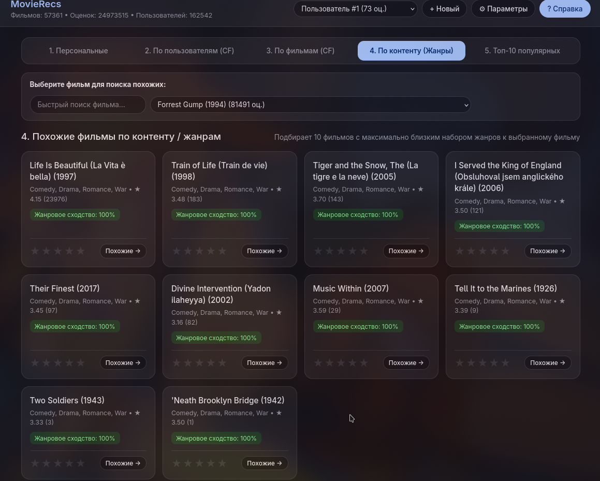

---

### 5 Топ 10 самых популярных фильмов

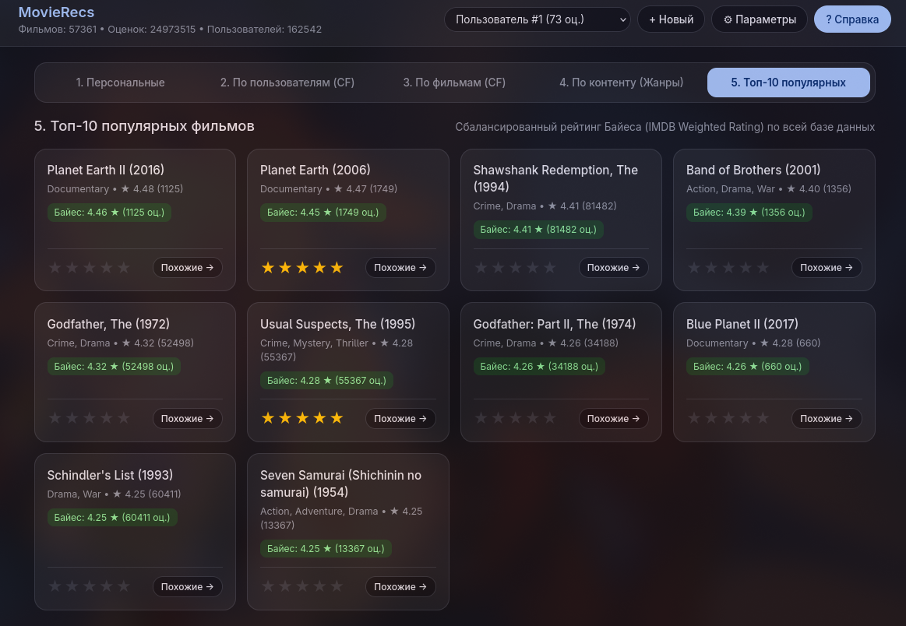

---

## Система выставления оценок фильму пользователем

> Чтобы поставить оценку фильму нужно нажать на иконку звёздочки и выставить предпологаемый `рейтинг от 1 до 5`

> Так же если вам очень понравился фильм и вы хотите посмотреть что то подобное вы можете нажать на кнопку `похожие`

### Пример работы системы оценивания

> Создан пользователь с 0 оценок, сейчас его рекомендаций стандартные тоесть просто самые популярные фильмы

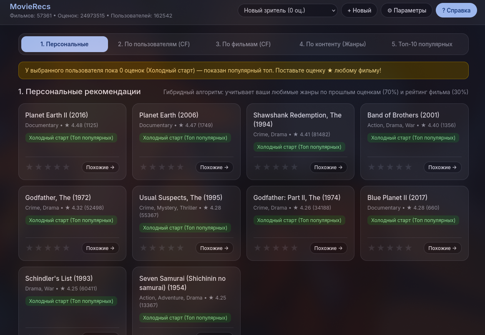

> Мы возьмём случайный фильм например `Band of Brothers (2001)` с жанрами `action, drama, war`

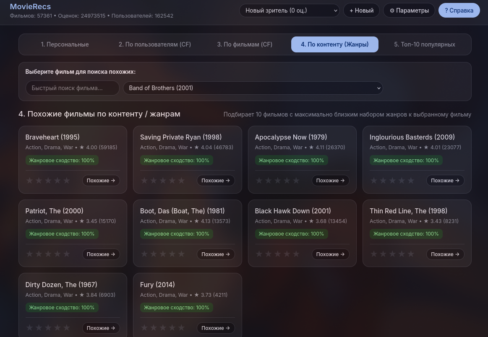

> Тут видим фильмы что похожи по жанрам на этот фильм выберем все подряд вставив оценки

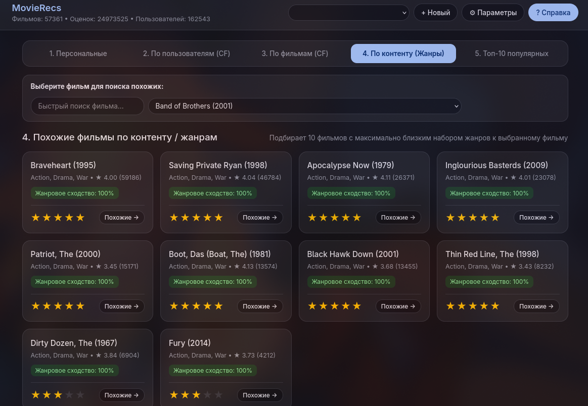

> Теперь мы можем заметить что Персональные рекомендаций для нашего пользователя стали такими

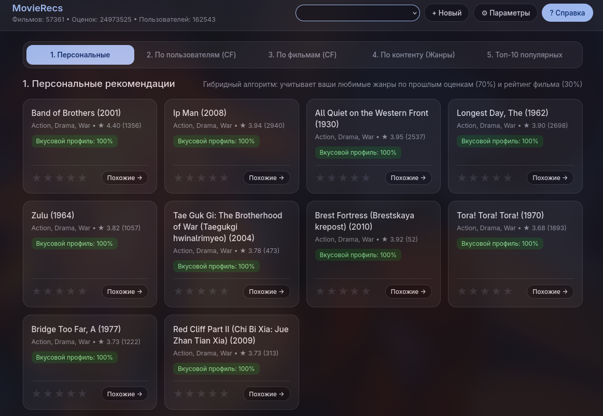

> Мы можем заметить что рекомендаций поменялись

### Рекомендаций на основе зрителей с похожими оценкам так же меняется в зависимости от оценок пользователя

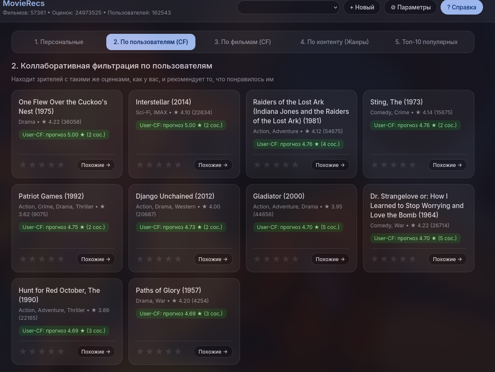

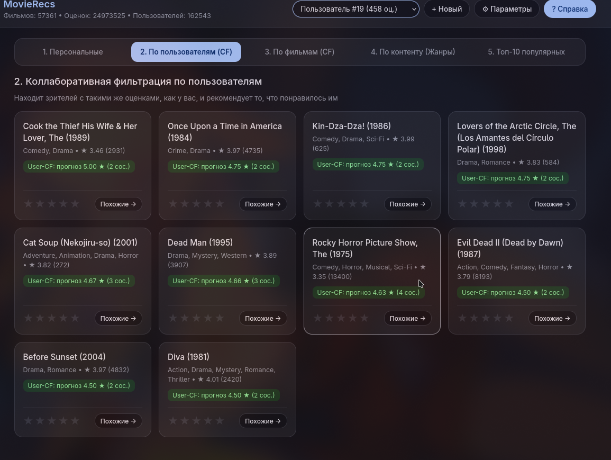
