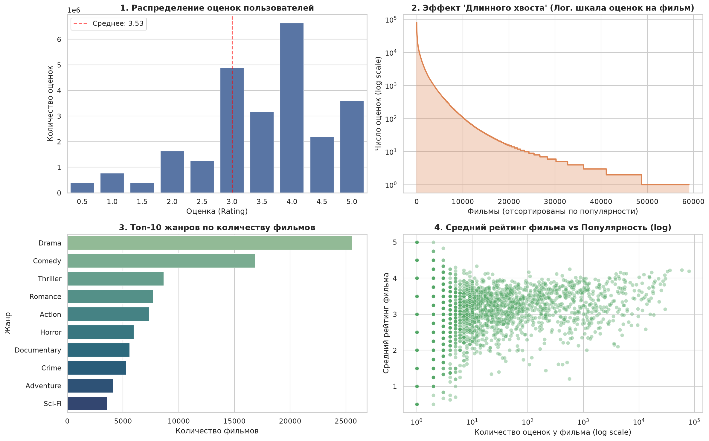
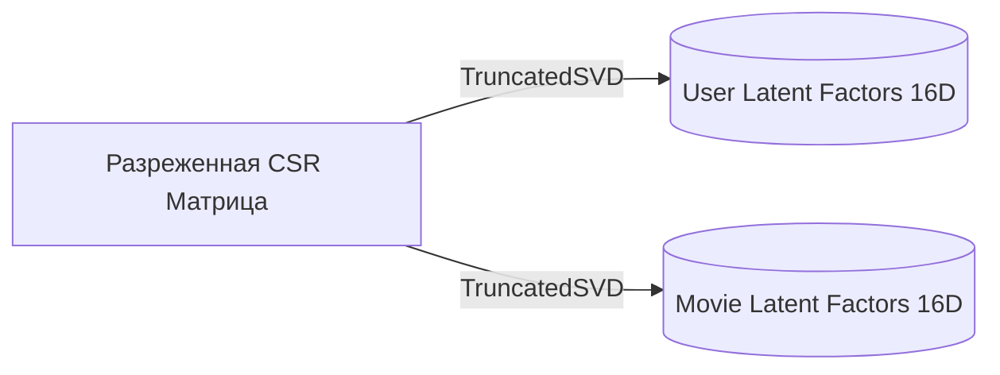
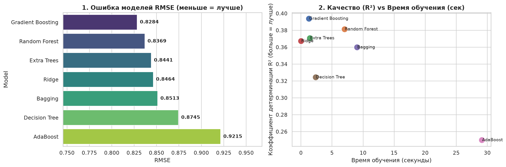

# MovieRecs — Рекомендательная система фильмов (Go + Python ML)

Учебный проект с двухконтурной архитектурой (**Two-Stage Architecture**):

- **Python (Офлайн-контур)**: Разведочный анализ данных (EDA), сжатие разреженной матрицы `scipy.sparse.csr_matrix`, латентные признаки `TruncatedSVD` (16 факторов) и сравнительный анализ 7 моделей регрессии.
- **Go (Онлайн-контур)**: Высокопроизводительный REST API на Gin, SQLite (WAL-режим), In-Memory индекс и динамический расчет рекомендаций в реальном времени (**Online Folding-In**).

---

## Описание проекта

**MovieRecs** — веб-приложение для персонализированных рекомендаций фильмов на основе датасета MovieLens. Система сочетает классические алгоритмы коллаборативной фильтрации (User-Based, Item-Based CF), матричную факторизацию (SVD), гибридный контентный анализ и прогнозирование оценок с помощью ML-моделей. Интерфейс позволяет оценивать фильмы от 1 до 5 звёзд, мгновенно пересчитывая выдачу в реальном времени.

---

## Структура проекта

```text
movie-recommender/
├── data/                              # Локальная директория датасета (movies.csv, ratings.csv)
│   ├── movies.csv                     # Информация о фильмах (id, title, genres, year)
│   └── ratings.csv                    # Оценки пользователей (userId, movieId, rating)
├── internal/
│   ├── database/
│   │   └── db.go                      # Инициализация SQLite (WAL-режим) и пакетный импорт CSV
│   ├── engine/
│   │   ├── engine.go                  # Ядро In-Memory индекса, кэширование норм и CRUD оценок
│   │   ├── ml.go                      # Инференс ML-модели (SVD + Gradient Boosting) из артефактов
│   │   ├── collaborative.go           # Коллаборативная фильтрация (User-Based и Item-Based CF)
│   │   └── content.go                 # Контентная фильтрация (жанры), гибридный профиль и рейтинг Байеса
│   ├── handlers/
│   │   └── handlers.go                # REST API роуты (Gin)
│   └── models/
│       └── models.go                  # Модели данных и параметры алгоритмов
├── web/
│   └── index.html                     # Интерактивный SPA-интерфейс (Material Design 3 Dark)
├── recommender.ipynb                  # Jupyter-ноутбук: EDA, обучение SVD и сравнение 7 моделей ML
├── model_artifacts.json               # Экспортированные латентные векторы и метрики лучшей модели
├── eda_dashboard.png                  # Дашборд разведочного анализа данных
├── models_comparison.png              # Графики сравнения 7 моделей ML
├── requirements.txt                   # Зависимости Python для ML-контура
├── go.mod                             # Зависимости Go-сервера
└── main.go                            # Точка входа HTTP-сервера
```

---

## ML-подход и исследование (Python)

### 1. Разведочный анализ данных (EDA)

В ноутбуке `recommender.ipynb` выполнен подробный разведочный анализ данных:

- Проверка качества данных: отсутствие пропусков (`NaN`) и дубликатов пар `(userId, movieId)`.
- Оценка разреженности матрицы взаимодействий (**Sparsity > 98%**).
- Исследование распределения оценок и проблемы «длинного хвоста» (**Long Tail Problem**).
- Анализ распределения фильмов по жанрам и динамика оценок в зависимости от популярности картины.



### 2. Сжатие разреженной матрицы (`csr_matrix`)

Матрица взаимодействий **пользователь × фильм** приводится к формату сжатых разреженных строк `scipy.sparse.csr_matrix`. Это позволяет хранить в ОЗУ только ненулевые оценки, сокращая потребление памяти с десятков гигабайт до десятков мегабайт.

### 3. Матричная факторизация TruncatedSVD

С помощью `TruncatedSVD` разреженная матрица раскладывается на две компактные таблицы по **16 скрытых (латентных) факторов**:



### 4. Сравнение 7 моделей регрессии

На основе статистических признаков (`u_mean`, `m_mean`, `u_count`, `m_count`) и скалярного произведения SVD-факторов (`svd_dot`) обучены и протестированы **7 алгоритмов регрессии** (`scikit-learn`):

1. **Ridge Regression**
2. **Decision Tree Regressor**
3. **Random Forest Regressor**
4. **Extra Trees Regressor**
5. **Bagging Regressor**
6. **AdaBoost Regressor**
7. **HistGradientBoosting Regressor**

Качество оценивалось на валидационной выборке по метрикам **RMSE**, **MAE**, **R²** и времени обучения:



> **Лучшая модель по итогам тестов**: `HistGradientBoosting Regressor` (показывает наименьшую ошибку RMSE и максимальный коэффициент детерминации R² при минимальном времени обучения).
> Векторы фильмов и метаданные экспортированы в `model_artifacts.json`.

---

## Алгоритмы рекомендательного движка (Go Backend)

В движке реализовано 5 независимых сценариев выдачи:

1. **Персональные рекомендации (User-Based Hybrid, Вкладка 1):**
   Комбинация профиля вкусов пользователя по оцененным жанрам (70%) и взвешенного рейтинга популярности фильма (30%).
2. **Коллаборативная фильтрация + ML (Вкладка 2):**
   - Динамическое проецирование профиля оценок пользователя в латентное пространство SVD методом **Online Folding-In** (расчет за доли миллисекунды прямо в RAM без перезапуска модели).
   - Прогноз оценки фильма по признакам `u_mean`, `m_mean` и `svd_dot`.
   - Автоматический фоллбэк на классический **User-KNN**, если файл `model_artifacts.json` отсутствует.
3. **По фильмам — Item-Based CF (Вкладка 3):**
   Поиск похожих фильмов на основе косинусного сходства оценок общих зрителей (_«С этим фильмом также смотрят»_).
4. **Контентная фильтрация (Content-Based, Вкладка 4):**
   Косинусное сходство нормализованных жанровых векторов фильмов.
5. **Топ популярных фильмов (Вкладка 5):**
   Сглаженный рейтинг Байеса по формуле IMDB:
   $$W = \frac{v}{v+m} \cdot R + \frac{m}{v+m} \cdot C$$
   где $v$ — число голосов у фильма, $m$ — порог сглаживания (`BayesM`), $R$ — средний балл фильма, $C$ — глобальное среднее по всей базе.

### Холодный старт (Cold Start)

Для новых пользователей с `0` оценок сервис автоматически переключается на выдачу Топа Байеса. При первой же оценке (1–5 ★) система исключает пользователя из режима холодного старта и мгновенно перестраивает персональную выдачу.

---

## Сводка REST API

| Метод  | Эндпоинт                        | Описание                                                           |
| :----- | :------------------------------ | :----------------------------------------------------------------- |
| `GET`  | `/api/stats`                    | Общая статистика базы данных, индекса и активной ML-модели         |
| `GET`  | `/api/users`                    | Список пользователей с фильтрацией `?q=`                           |
| `POST` | `/api/users`                    | Создание профиля нового пользователя (проверка «Холодного старта») |
| `GET`  | `/api/movies`                   | Поиск фильмов по названию и жанрам `?q=`                           |
| `GET`  | `/api/movies/top`               | Вкладка 5: Топ популярных фильмов (рейтинг Байеса)                 |
| `GET`  | `/api/users/:id/personal`       | Вкладка 1: Персональные рекомендации (70% жанры + 30% Байес)       |
| `GET`  | `/api/users/:id/collaborative`  | Вкладка 2: ML-прогноз (SVD + Boosting) / User-Based KNN            |
| `GET`  | `/api/movies/:id/collaborative` | Вкладка 3: Похожие фильмы через Item-Based CF                      |
| `GET`  | `/api/movies/:id/content`       | Вкладка 4: Похожие фильмы по жанровому сходству                    |
| `POST` | `/api/ratings`                  | Добавление/обновление оценки с мгновенным пересчетом в ОЗУ         |

**Пример тела запроса для `POST /api/ratings`:**

```json
{
  "user_id": 1,
  "movie_id": 10,
  "rating": 4.5
}
```

---

## Запуск проекта

### 1. Подготовка ML-артефактов (Python)

_(Опционально: готовый `model_artifacts.json` уже находится в репозитории)_

```bash
# Создание виртуального окружения
python3 -m venv .venv
source .venv/bin/activate

# Установка зависимостей
pip install -r requirements.txt

# Запуск ноутбука для переобучения моделей
jupyter lab recommender.ipynb
```

### 2. Запуск сервера (Go)

При первом запуске сервер автоматически создаст базу данных `movies.db`, загрузит CSV-файлы из папки `data/`, построит индекс в RAM и подключит ML-артефакты:

```bash
go mod tidy
go run .
```

Веб-интерфейс доступен в браузере по адресу: **[http://localhost:8080](http://localhost:8080)**

---

## Технологический стек

- **Python ML-контур:** `scikit-learn`, `scipy`, `pandas`, `numpy`, `matplotlib`, `seaborn`, `jupyter`.
- **Go Backend:** Go 1.22+, `gin-gonic/gin`, `jmoiron/sqlx`, `modernc.org/sqlite` (чистый Go без CGO, поддержка WAL).
- **Frontend:** Vanilla JavaScript, HTML5, CSS3 (Material Design 3 Dark Theme).

---

## Лицензия

MIT License — учебный проект.
